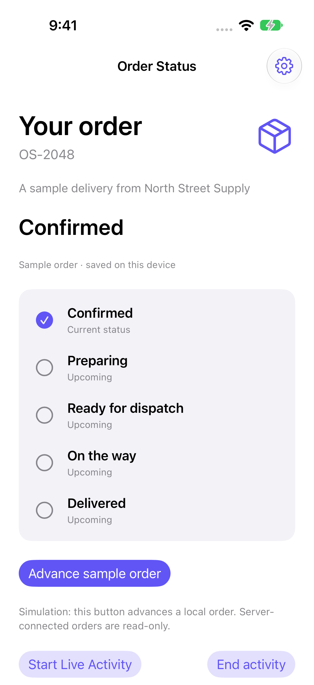

# Order Status Live

A native order timeline with a cached widget and an ActivityKit Live Activity.

[](https://github.com/DawoodAamir/Order-Status-Live/actions/workflows/ci.yml)

[](LICENSE)



## Features

- Track five ordered stages and persist the latest status.
- Separate a labelled sample progression from read-only server tracking.
- Reject stale revisions and restrict server changes to an operator token.
- Show cached status in a WidgetKit extension and local updates in a Live Activity.

## Run locally

Open **Order Status Live.xcodeproj** and run the shared scheme. Advance the sample order to see its timeline update. Add the Order Status widget to the Simulator home screen.

For connected tracking, run `python3 Server/server.py`, open Connection settings, enter `http://localhost:8092`, and use `sample-reader`. Update the order as an operator:

```sh
curl -X POST http://localhost:8092/orders/OS-2048 \
  -H 'Authorization: Bearer sample-operator' \
  -H 'Content-Type: application/json' \
  -d '{"stage":1,"revision":0}'
```

Advance one stage at a time and supply the latest revision. The app refreshes every five seconds while its screen is active. Local and server sample modes start independent order histories.

**Signing:** register your own App Group, update `group.com.dd.orderstatus` in both targets and their entitlements, and enable it for your own signing team. Host and widget must use the same group. The widget displays a sample when no shared container is available.

Order tracking and the home-screen widget support iOS 15. Live Activities use iOS 16.2+ APIs, update locally, and end at Delivered or on request. Remote APNs Live Activity updates are outside this reference implementation. Signed-device widget sharing and background Live Activity behaviour still need device validation.

## Structure

- `Sources/Core`: domain logic, also exposed through a Swift Package for tests.
- `Sources/App`: native SwiftUI screens and platform integrations.
- `Tests/Core`: domain regression tests.
- `Tests/UI`: native workflow tests with isolated saved state and retained screenshots.
- `Resources`: assets, app icon, and platform configuration.
- `Server`: local reference API and isolated HTTP regression tests.

## Verification

Requires Xcode 15 or newer for these sources; local checks use the installed Xcode toolchain. No developer team is committed. Simulator builds need no personal signing identity. A physical device requires your own signing and capabilities.

```sh
swift test
swift test -c release
bash Scripts/test-ui.sh
```

CI runs the core tests, a Release build, and native workflow tests. The reference APIs have separate backend checks. See [verification notes](Docs/Verification.md) for the tested environment and remaining device checks.

## Privacy and contribution

The latest order is stored locally and, when entitled, in the shared App Group for the widget. The selected service receives a read token and serves sample status; the client cannot alter remote orders. No analytics.

See [PRIVACY.md](PRIVACY.md), [CONTRIBUTING.md](CONTRIBUTING.md), and [LICENSE](LICENSE). All example people, assignments, accounts, and order identifiers are fictional. No App Store seller account is connected to this project.
